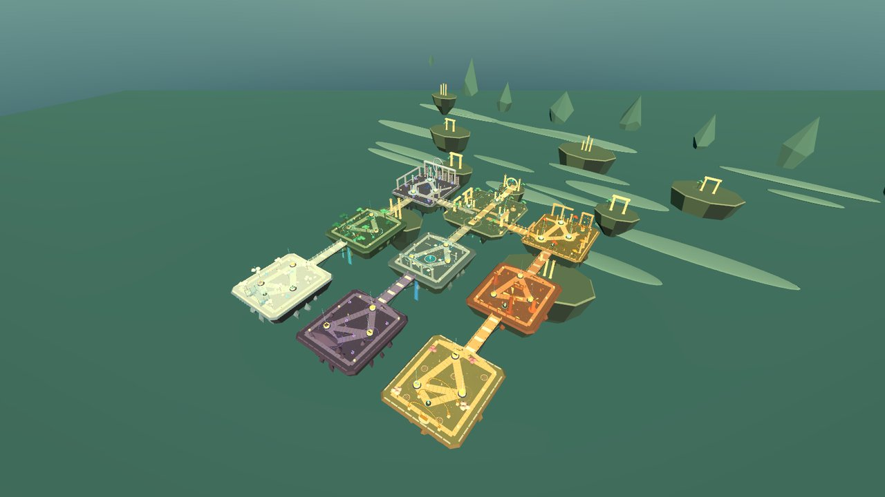
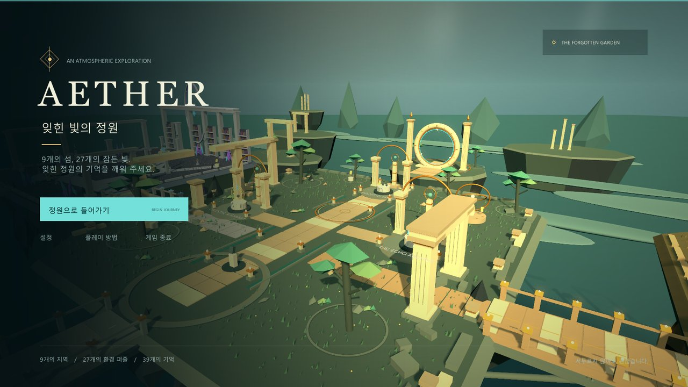
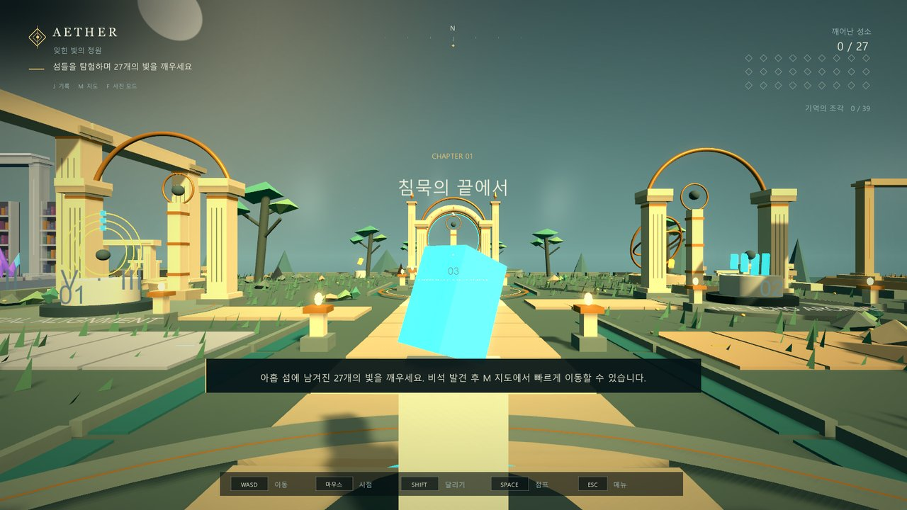
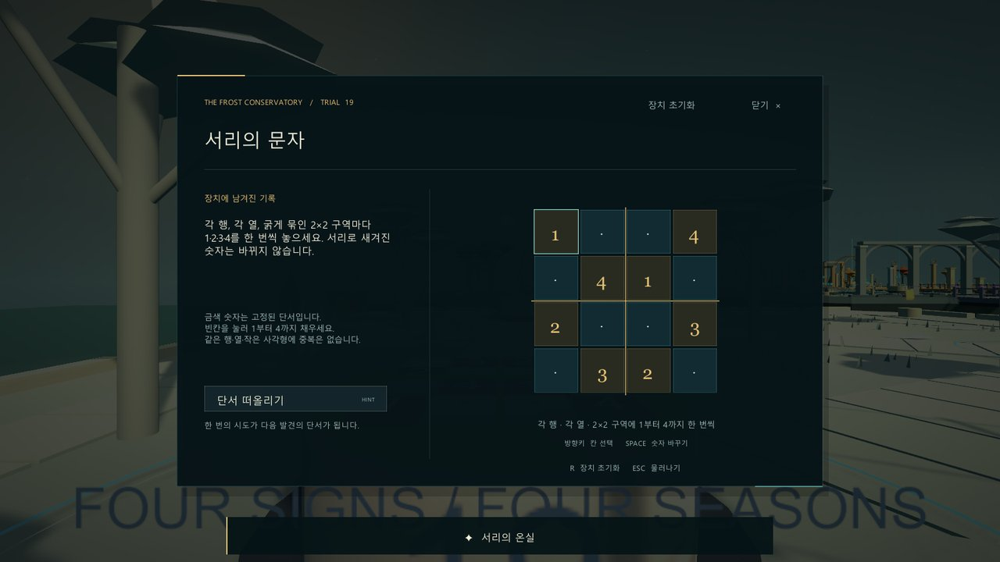
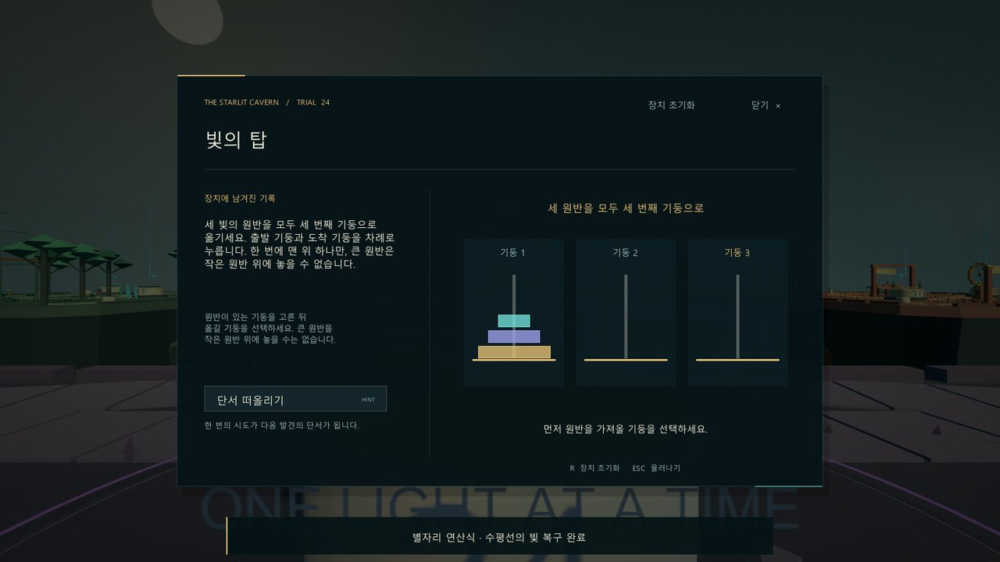
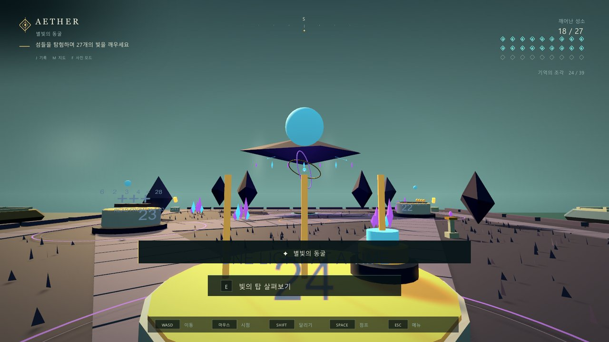
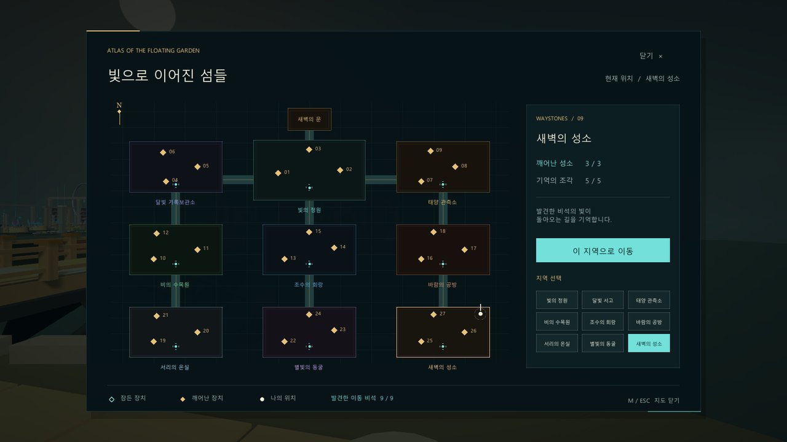

# AETHER — 잊힌 빛의 정원

아홉 개의 공중 정원을 돌아다니며 27개 성소의 퍼즐을 풀고 39개 기록을 모으는 1인칭 3D 탐험·퍼즐 게임입니다. 과제가 아니라 Unity로 혼자 만든 개인 프로젝트입니다.

| 항목 | 내용 |
| --- | --- |
| 형태 | 개인 프로젝트 (2026년 9월) |
| 엔진 · 언어 | Unity 2022.3 LTS, C# |
| 규모 | C# 스크립트 13개 약 7,300줄, 에디터 스크립트 2개, 셰이더 2개 |
| 콘텐츠 | 지역 9개, 퍼즐 27개, 기록 39개, 이동 비석 9개, 결말 2개 |
| 플랫폼 | Windows 64비트, 키보드 · 마우스 |
| 실행 파일 | [Releases에서 내려받기](https://github.com/bestlim1/Aether/releases/latest) |

## 화면

<table>
  <tr>
    <td></td>
    <td></td>
  </tr>
  <tr>
    <td align="center">제목 화면</td>
    <td align="center">중앙 정원 탐험</td>
  </tr>
  <tr>
    <td></td>
    <td></td>
  </tr>
  <tr>
    <td align="center">퍼즐 19 서리의 문자 (4×4 스도쿠)</td>
    <td align="center">퍼즐 24 빛의 탑 (하노이 탑)</td>
  </tr>
  <tr>
    <td></td>
    <td></td>
  </tr>
  <tr>
    <td align="center">별빛의 동굴</td>
    <td align="center">지도와 빠른 이동</td>
  </tr>
</table>

## 게임 구성

- **탐험**: 중앙 정원에서 다리로 이어진 아홉 개의 섬을 자유로운 순서로 돌아다닙니다. 전투와 시간 제한은 없습니다.
- **퍼즐**: 섬마다 성소 3개가 있고, 27개를 모두 풀면 마지막 문이 열립니다. 막히면 힌트를 보거나 초기화할 수 있습니다.
- **기록과 결말**: 섬 곳곳의 기록 39개를 모아 등장인물 8명의 이야기를 읽습니다. 기록까지 모두 모으면 두 번째 결말이 열립니다.
- **편의 기능**: 지도와 이동 비석을 통한 빠른 이동, 기록 일지, 사진 모드, 자동 저장, 소리·화면 움직임·마우스 감도·그래픽 품질 설정을 지원합니다.

퍼즐은 잘 알려진 논리 퍼즐을 게임 장치로 옮긴 것이 많습니다.

| 유형 | 성소 |
| --- | --- |
| 격자 논리 | 서리의 문자 (4×4 스도쿠), 얼음의 자수 (노노그램), 네 개의 별 (4-퀸), 정원의 합 (행·열 합), 빛의 순환 (Lights Out) |
| 상태 탐색 | 작은 나룻배 (강 건너기), 빛의 탑 (하노이 탑), 두 항아리 (물통 문제), 새벽의 다리 (다리 건너기) |
| 배치 · 회전 | 천구의 정렬, 조각난 별자리 (슬라이딩 퍼즐), 새벽의 거울, 맞물린 시간 |
| 기억 · 추리 | 메아리의 기억 (음 순서 재현), 관측자의 암호 (위치·숫자 단서), 별자리 연산식 (연산 기호 찾기) |

27개 전체 목록과 지역별 위치는 [플레이 안내서](docs/GUIDE.md)에 있습니다.

## 구현 포인트

- **외부 에셋 없이 코드로 만든 세계**: 씬 파일은 비어 있고, 게임을 실행하면 코드가 섬 지형, 건물, 다리, 식물을 메시로 만들어 배치합니다. 하늘과 화면 색감은 직접 작성한 셰이더 2개로 처리합니다.
- **절차적 음악과 효과음**: 음원 파일을 쓰지 않습니다. 사인파와 배음을 합치고 감쇠를 걸어 지역별 배경음과 장치 소리를 `AudioClip`으로 생성합니다.
- **저장 검사와 이전 저장 호환**: 진행 상태를 JSON으로 저장하고 불러올 때 형식과 배열 크기를 검사해 손상된 저장은 거부합니다. 지역이 추가되기 전에 만든 저장을 불러오면 기존 진행은 보존하고 나중에 추가된 지역은 미완료로 붙입니다.
- **테스트가 실제 저장을 건드리지 않는 구조**: 저장 접근을 `AetherSaveStore` 한 곳으로 모으고, 자동 테스트 모드에서는 메모리 저장소를 쓰도록 분리했습니다.
- **퍼즐이 풀리는지 코드로 검증**: 스도쿠·노노그램·암호는 가능한 배치를 전수 조사해 해가 하나뿐인지 확인합니다. 나룻배·탑·항아리·다리는 상태 그래프를 탐색해 최단 풀이(7수, 7수, 6수, 17분)가 있는지 확인합니다.
- **빌드와 자동 플레이 검증**: Unity 에디터에 `AETHER` 메뉴를 만들었습니다. 빌드한 실행 파일을 테스트 모드(`-aether-smoke`)로 띄워 27개 퍼즐 풀이, 저장 호환, 다리 횡단, 비석 이동, 결말까지 355개 항목을 자동으로 확인하고 결과를 JSON으로 남깁니다.

## 검증 결과

2026년 9월 17일, Unity 2022.3.45f1 / Windows 64비트 기준입니다. 원본 결과는 [docs/validation](docs/validation)에 있습니다.

| 항목 | 결과 |
| --- | --- |
| Windows 빌드 | 성공, 오류 0 · 경고 0 |
| 퍼즐 규칙 검사 | 481,499건 통과 |
| 실행 파일 자동 플레이 | 355개 항목 통과 |

## 조작

| 동작 | 키 |
| --- | --- |
| 이동 / 둘러보기 | W · A · S · D / 마우스 |
| 장치 조작 · 기록 수집 | E |
| 달리기 / 점프 | 왼쪽 Shift / Space |
| 지도 · 빠른 이동 / 기록 일지 | M / J |
| 사진 모드 / 스크린샷 | F / F12 |
| 힌트 (퍼즐 화면) | H |
| 닫기 · 일시정지 | Esc |

## 실행 방법

**바로 플레이**: [Releases](https://github.com/bestlim1/Aether/releases/latest)에서 `AETHER-Windows.zip`을 받아 압축을 풀고 `Aether.exe`를 실행합니다.

**Unity에서 열기**

1. Unity Hub에서 Unity **2022.3.45f1**로 이 폴더를 엽니다.
2. 메뉴 **AETHER → Prepare project**를 한 번 실행합니다.
3. `Assets/Scenes/Sanctuary.unity`를 열고 Play를 누릅니다. 세계는 실행할 때 만들어지므로 편집 모드에서 씬이 비어 보이는 것이 정상입니다.

| 메뉴 | 동작 |
| --- | --- |
| AETHER → Validate puzzle logic | 퍼즐 규칙 검사 |
| AETHER → Build Windows player | `Aether-Windows/`에 실행 파일 빌드 (Windows Build Support (Mono) 필요) |
| AETHER → Build and verify journey | 빌드 후 실행 파일 자동 플레이 검증, 결과는 `Validation/` |

## 코드 구성

| 파일 | 역할 |
| --- | --- |
| `AetherGame.cs` | 게임 흐름, 중앙 성소, 저장, 자동 검증 |
| `AetherJourney.cs` | 지도, 일지, 사진 모드, 결말, 설정 |
| `AetherExpansion.cs` | 동서 지역 성소 6개 |
| `AetherFrontiers.cs` · `AetherFrontierJourney.cs` | 중간 세 지역의 성소 9개와 기록 15개 |
| `AetherHorizons.cs` · `AetherHorizonJourney.cs` | 마지막 세 지역의 성소 9개, 기록 15개, 이동 비석 |
| `AetherWorld.cs` · `AetherFrontierWorld.cs` · `AetherHorizonWorld.cs` | 섬 지형, 식물, 건축, 다리, 날씨 효과 생성 |
| `AetherPlayer.cs` | 이동, 시점, 낙하 복귀 |
| `AetherUI.cs` · `AetherAudio.cs` | 한국어 UI, 절차적 음악·효과음 |
| `AetherSaveStore.cs` | 실제 저장과 테스트용 저장 분리 |
| `Editor/AetherBuild.cs` | 준비 · 검증 · 빌드 메뉴 |
